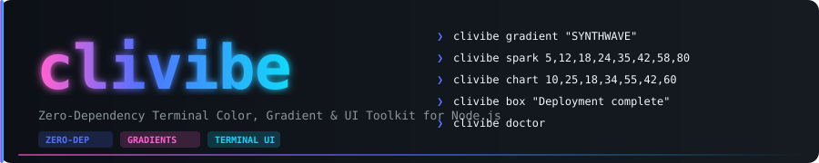

<div align="center">



<br/>

**Zero-dependency terminal color, gradient, and UI toolkit for Node.js.**

[](https://www.npmjs.com/package/clivibe)
[](https://www.npmjs.com/package/clivibe)
[](LICENSE)
[](https://nodejs.org)
[](https://github.com/dnuzi/clivibe/discussions)
[](https://github.com/sponsors/dnuzi)

</div>

---

## Install

```sh
npm install clivibe
```

```sh
npx clivibe
```

---

## Terminal Colors

```js
import { c } from 'clivibe/colors';

console.log(c.red('error'));
console.log(c.bgBlue.white.bold(' INFO '));
console.log(c.hex('#FF61D2')('custom hex'));
console.log(c.rgb(80, 200, 120)('rgb color'));
```

Supports chaining of styles — bold, dim, italic, underline, inverse, strikethrough, and all standard + bright foreground/background colors.

---

## Gradients

```js
import { gradients, gradient } from 'clivibe/colors';

// Built-in presets
console.log(gradients.rainbow('Hello, World!'));
console.log(gradients.synthwave('SYNTHWAVE'));
console.log(gradients.fire('  HOT  '));

// Custom gradient
const ocean = gradient(['#00c6ff', '#0072ff']);
console.log(ocean('Gradient text'));

// HSV-spin (smooth color wheel rotation)
const spin = gradient(['#ff0000', '#0000ff'], { interpolation: 'hsv', hsvSpin: 'long' });
console.log(spin('Spectrum'));
```

**Available presets:** `rainbow` `pastel` `cristal` `mind` `passion` `retro` `fire` `cyber` `synthwave` `aurora` `sunset` `vice` `fruit` `summer` `atlas` `sublime`

---

## Boxes

```js
import { createBox } from 'clivibe/box';

console.log(createBox('Deployment complete.', 'STATUS', '#5271FF'));
// Border styles: round · single · double · bold · classic
console.log(createBox('Warning text', 'WARN', '#FFB199', { style: 'double' }));
```

---

## Progress Bars

```js
import { ProgressBar } from 'clivibe/progress';

const bar = new ProgressBar({ total: 100, width: 40, gradient: ['#5271FF', '#FF61D2'] });
bar.update(75);
bar.complete();
```

---

## Charts

```js
import { sparkline, plot } from 'clivibe/chart';

console.log(sparkline([10, 25, 18, 34, 55, 42, 60, 35]));
// ▁▃▂▄▆▅▇▄

console.log(plot([10, 25, 18, 34, 55, 42, 60, 35], { label: 'Requests/s' }));
```

---

## Widgets

```js
import { renderTree, renderGauge, badge, divider, keyvalue } from 'clivibe/widgets';

// Directory tree
renderTree({ name: 'src', children: [{ name: 'index.js' }, { name: 'utils.js' }] });

// Gauge meter
console.log(renderGauge(72, { label: 'CPU' }));

// Inline badge
console.log(badge('v1.2.0', '#5271FF'));

// Key-value table
keyvalue({ Version: '1.2.0', License: 'MIT', Platform: 'Node.js >= 18' });

// Section divider
console.log(divider('SECTION'));
```

---

## Spinner

```js
import { createSpinner } from 'clivibe';

const spinner = createSpinner('Loading...').start();
await doWork();
spinner.stop('Done');
```

---

## Image Rendering

```js
import { renderImage } from 'clivibe';

// Render a PNG or BMP file using half-block characters with TrueColor
await renderImage('./screenshot.png', { width: 80 });
```

---

## Glyphs & Badges

```js
import { glyphs, badges } from 'clivibe/colors';

console.log(glyphs.success + ' Build passed');   // ✔ Build passed
console.log(glyphs.error   + ' Build failed');   // ✖ Build failed
console.log(glyphs.warning + ' Check config');   // ▲ Check config

console.log(badges.primary('PASS'));
console.log(badges.error('FAIL'));
console.log(badges.info('INFO'));
```

---

## CLI Commands

```
clivibe [command] [options]
cv      [command] [options]        (short alias)
```

| Command | Description |
|---|---|
| `clivibe menu` | Interactive command launcher |
| `clivibe doctor` | System and project environment diagnostics |
| `clivibe git` | Git workflow shortcuts |
| `clivibe scaffold` | Project scaffolding |
| `clivibe top` | Real-time process monitor |
| `clivibe logsee <file>` | Structured log viewer |
| `clivibe wtf "<error>"` | Error pattern analyzer |
| `clivibe utils curl <url>` | HTTP inspector |
| `clivibe utils cron "<expr>"` | Cron expression decoder |
| `clivibe hash <value>` | Hash generator |
| `clivibe gradient "<text>"` | Render gradient text |
| `clivibe spark <values>` | Render sparkline chart |
| `clivibe chart <values>` | Render 2D line chart |
| `clivibe image <file>` | Render image in terminal |
| `clivibe box "<text>"` | Render bordered box |

---

## API Reference

### `c` — Styler

```
c.red · c.green · c.blue · c.yellow · c.cyan · c.magenta · c.white · c.gray
c.bgRed · c.bgGreen · c.bgBlue · c.bgYellow · c.bgCyan · c.bgMagenta · c.bgWhite
c.bold · c.dim · c.italic · c.underline · c.inverse · c.strikethrough
c.hex('#RRGGBB') · c.rgb(r, g, b)
c.bgHex('#RRGGBB')
```

All modifiers are chainable: `c.bgBlue.white.bold('text')`.

### `gradient(colors, options?)` — Gradient Factory

| Option | Type | Default | Description |
|---|---|---|---|
| `interpolation` | `'rgb'` \| `'hsv'` | `'rgb'` | Interpolation mode |
| `hsvSpin` | `'short'` \| `'long'` | `'short'` | HSV rotation direction |

### `gradients` — Preset Map

All presets are callable: `gradients.rainbow(str)`, `gradients.fire(str)`, etc.

---

## Zero Dependencies

clivibe uses only Node.js built-ins — `zlib`, `net`, `fs`, `child_process`, `readline`. Nothing is downloaded from the npm registry at runtime.

---

## Contributing

Contributions, issues, and feature requests are welcome.
[Open a discussion](https://github.com/dnuzi/clivibe/discussions) · [File an issue](https://github.com/dnuzi/clivibe/issues)

---

## License

[MIT](LICENSE) © [DanuZz](https://github.com/dnuzi)
